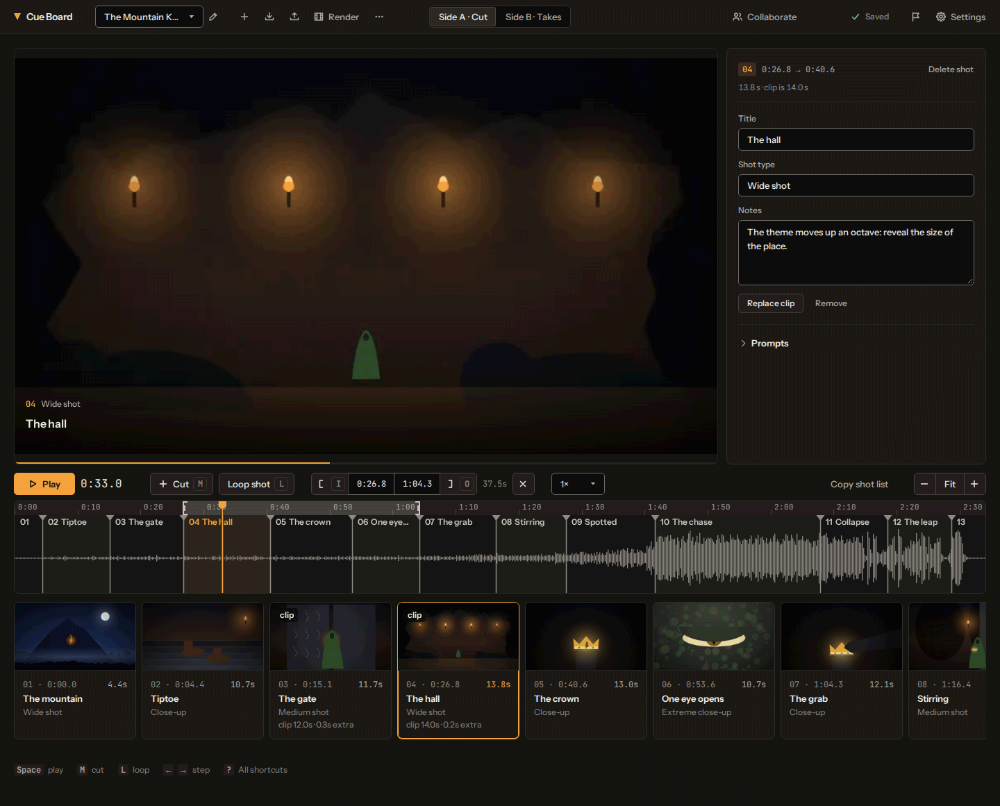
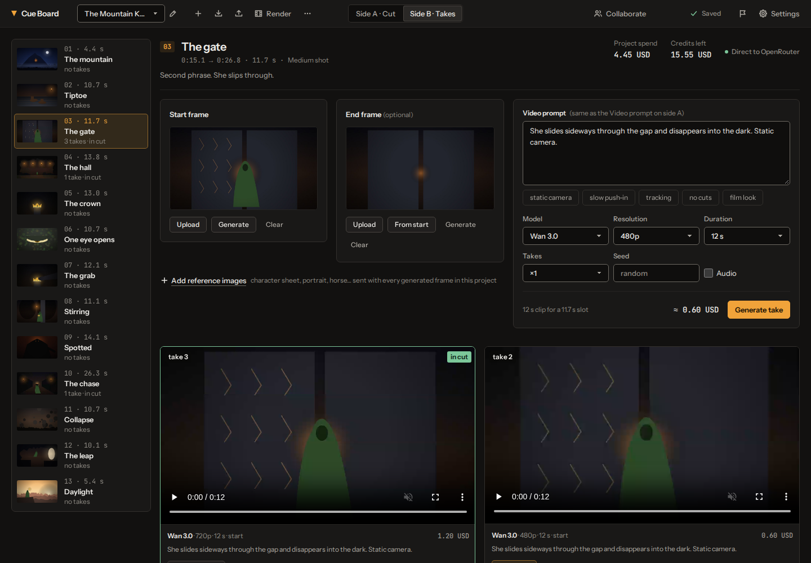
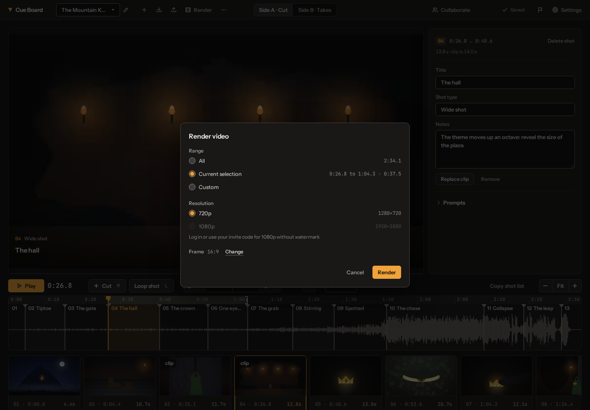
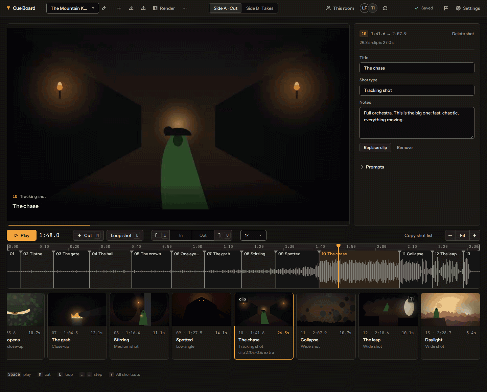
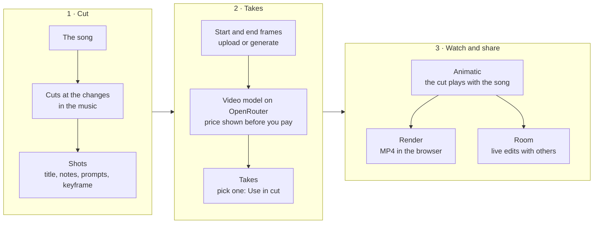
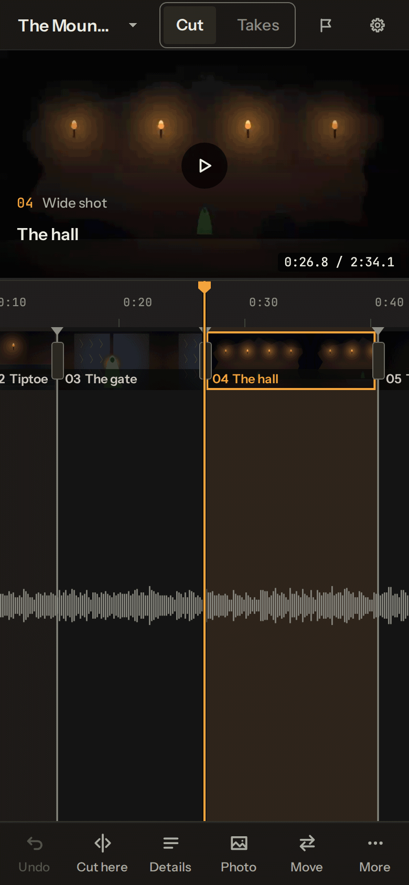
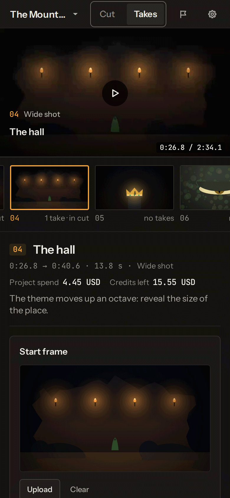
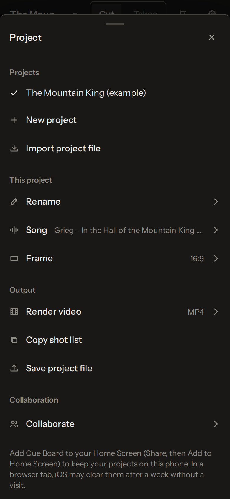

<p align="center">
  
</p>

<h1 align="center">Cue Board</h1>

<p align="center">
  <b>Plan your AI music video against the song, shot by shot.</b><br>
  Cut the song into shots. Make a take for each shot. Watch the cut play with the music.
</p>

<p align="center">
  <a href="https://cue.bedrocklabs.dev">Live app</a> ·
  <a href="#how-it-works">How it works</a> ·
  <a href="#run-it-locally">Run it locally</a> ·
  <a href="docs/DEVELOP.md">Develop</a>
</p>

<table align="center">
  <tr>
    <td align="center" width="25%"><a href="docs/readme/cut.png"></a></td>
    <td align="center" width="25%"><a href="docs/readme/takes.png"></a></td>
    <td align="center" width="25%"><a href="docs/readme/render.png"></a></td>
    <td align="center" width="25%"><a href="docs/readme/room.png"></a></td>
  </tr>
  <tr>
    <td align="center" width="25%"><b>1. Cut the song</b><br><sub>Mark a cut at each change in the music. Each part is a shot.</sub></td>
    <td align="center" width="25%"><b>2. Make the takes</b><br><sub>Make frames and video with OpenRouter. The app shows the price first.</sub></td>
    <td align="center" width="25%"><b>3. Render</b><br><sub>Make an MP4 of the cut in your browser.</sub></td>
    <td align="center" width="25%"><b>4. Work together</b><br><sub>Share a project. Edit it live with other people.</sub></td>
  </tr>
</table>

## What Cue Board is

Cue Board is for people who make a music video with AI video models. You start with the song. You mark a cut at
each change in the music. Each part between two cuts is a shot. A shot has a title, notes, a frame prompt, a motion
prompt and a keyframe. The monitor plays the shots in order with the song. You see the rhythm of the video before you
spend money on it.

The tool has two sides. On **Cut**, you plan the video: cuts, notes, prompts and keyframes. On **Takes**, you make
the media: a start frame, an optional end frame, and video takes for each shot. The app uses
[OpenRouter](https://openrouter.ai) with your own key. Select **Use in cut** on the take you like. The cut then plays
that take.

Your work stays in **your browser**. IndexedDB stores the song, the frames, the takes and your API key. The app sends
nothing to a server. There are two exceptions: the generation requests that you send to OpenRouter, and the room sync
when you share a project.

You can use the app alone for free. An account lets you make collaboration rooms and render at 1080p without the
watermark. An account costs 9 USD once, or you can use an invite code. You do not need an account to join a room with
a link.

| Fact | Value |
|---|---|
| Files the app needs | 1: `index.html` (364 KB). Two more files load only when needed: `collab.js` and `mp4-muxer.js` |
| Build step, `npm install` | None |
| Requests to third parties | None, except your own calls to OpenRouter. The app hosts the fonts itself |
| Frame ratios | 4: 16:9, 9:16, 1:1, 4:3 |
| Render | MP4 at 30 fps. Everyone gets 720p with a small watermark. An account gives 1080p without it |
| Files between collaborators | Peer to peer, in 64 KiB chunks. The app checks each file against its SHA-256 hash. The relay accepts files up to 2 GiB |
| Example project | 13 shots on a 2:34 public-domain recording of Grieg's *In the Hall of the Mountain King*. Each shot has a painted keyframe. Three shots have video takes |

## How it works



1. **The whole app is one page.** [`index.html`](index.html) has no build step and no dependencies. It works from
   [cue.bedrocklabs.dev](https://cue.bedrocklabs.dev), from any static host, or from a local file. Projects stay in
   IndexedDB. **Save project file** writes a `.cueboard.json` file. You can open it on another computer.
2. **Generation goes from your browser to OpenRouter.** The browser stores your key and sends it only to OpenRouter.
   Before each take, the app shows an estimate from the OpenRouter prices. After each take, it shows the real cost.
   To keep the key out of the browser, use [`server.mjs`](server.mjs). It is a small local relay that holds the key.
3. **The render runs on your computer.** Chrome and Edge use WebCodecs and the vendored
   [mp4-muxer](https://github.com/Vanilagy/mp4-muxer). They render faster than real time. Other browsers record the
   cut in real time. Each shot shows its take, its keyframe, or black. The app uploads nothing.
   ([`docs/specs/export-render.md`](docs/specs/export-render.md))
4. **A room syncs the project, not your files.** The sync server keeps one Yjs document for each room
   ([`packages/sync-server`](packages/sync-server)). The app side is [`packages/collab-client`](packages/collab-client).
   It is built into `collab.js`, which loads only for projects in a room. A project that you do not share never uses
   the network.
5. **Frames and takes go from browser to browser.** The app sends each file over WebRTC, encrypted. The receiver
   checks the file against its hash. If two people cannot connect directly, the sync server relays the bytes. It
   keeps none of them. ([`docs/media-p2p.md`](docs/media-p2p.md))
6. **An account is an email.** [`packages/auth`](packages/auth) sends a login link to the email you paid with, or to
   the email you enter with an invite code. There are no passwords. The sync server checks the signature of the
   session itself. It does not call the auth service.

## On a phone

<table align="center">
  <tr>
    <td align="center"></td>
    <td align="center"></td>
    <td align="center"></td>
  </tr>
  <tr>
    <td align="center"><b>Cut</b><br><sub>Scroll the song under the playhead. Tap a shot to edit it.</sub></td>
    <td align="center"><b>Takes</b><br><sub>The same shots, with their frames and takes.</sub></td>
    <td align="center"><b>Project</b><br><sub>Song, frame, render and sharing are in one sheet.</sub></td>
  </tr>
</table>

Add Cue Board to your home screen. It then opens as an app. On an iPhone, this also stops iOS from deleting your
projects after one week without a visit.

## What works today

- [x] Cut a song into shots with notes, prompts and keyframes. Play the cut as an animatic.
- [x] Make frames and video takes with OpenRouter. The app shows the price before and the cost after.
- [x] Takes continue to run if you reload the page.
- [x] Render the whole cut, or a section, to MP4 in 16:9, 9:16, 1:1 or 4:3.
- [x] Save and open projects as `.cueboard.json` files.
- [x] Use live collaboration rooms. Collaborators share frames, takes and the song.
- [x] Sign in with an email: a one-time purchase or an invite code.
- [x] Undo and redo, also in a room. Your undo never removes the work of another person.
- [x] Use a phone layout and install the app to the home screen.
- [x] Report a problem from the app with the flag next to Settings.
- [ ] Read-only links and access for each person in a room. Today a room has one link, and it can edit everything.
- [ ] Keep the files of a room available when nobody who has them is online.

## Run it locally

1. Download the repository.
2. Open `index.html` in Chrome, Edge or Firefox.

The example project opens on the first visit. You can try both sides before you load your own song. To make frames
and takes, paste an [OpenRouter key](https://openrouter.ai/keys) in **Settings**.

When you open `index.html` as a file, the example has no pictures and no takes. The browser does not let a file page
load them. To see them, use the local relay below or the live app.

To keep the key out of the browser, use the local relay. It needs Node 18 or later. It does not need `npm install`.

```bash
OPENROUTER_API_KEY=sk-or-... node server.mjs
```

Then open http://localhost:5173. The relay listens only on `127.0.0.1`.

Collaboration is off in a local copy because the sync server URL in `index.html` is empty. To run the sync server,
the account service and the checks, read [`docs/DEVELOP.md`](docs/DEVELOP.md).

## Project layout

```
index.html               The whole app
server.mjs               Optional local relay for the OpenRouter key
collab.js                Collaboration client, built from packages/collab-client
mp4-muxer.js             Vendored MP4 muxer, loaded by the render dialog
example/                 The example project, its song, and its pictures and takes (made by design/example-art.mjs)
fonts/, icons/           Fonts that the app hosts, app icons
manifest.webmanifest     Phone install file
packages/sync-server     Yjs sync server: rooms, invite links, media relay, problem reports
packages/collab-client   The app side of collaboration and media between peers
packages/auth            Accounts: email login links, purchases, invite codes
design/                  Browser checks and screenshot scripts (Playwright)
docs/                    How collaboration, media and reports work; specs; notes for developers
```

## Documentation

| Document | Contents |
|---|---|
| [`docs/DEVELOP.md`](docs/DEVELOP.md) | How to run, build and test; side B in detail; collaboration for operators |
| [`docs/collaboration.md`](docs/collaboration.md) | How the app talks to a room |
| [`docs/media-p2p.md`](docs/media-p2p.md) | How files go between collaborators |
| [`docs/reports.md`](docs/reports.md) | Problem reports |
| [`DESIGN.md`](DESIGN.md) | The design system |
| [`docs/specs/`](docs/specs) | Specs and reports for render, phone layout, selection and accounts |

## License

MIT. See [`LICENSE`](LICENSE). The fonts use the SIL Open Font License (`fonts/OFL-*.txt`). The example song is a
public-domain recording by the Musopen Symphony Orchestra.
