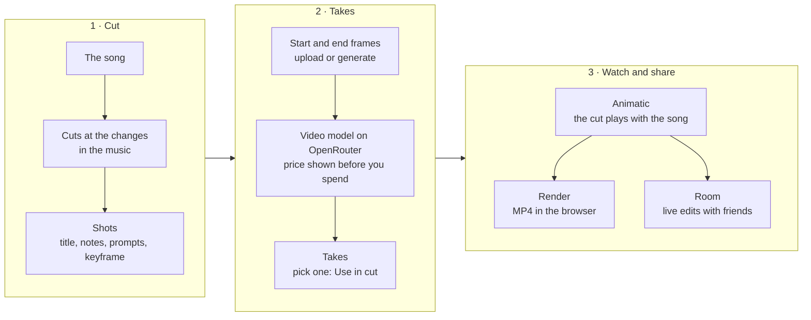

<p align="center">
  
</p>

<h1 align="center">Cue Board</h1>

<p align="center">
  <b>Plan your AI music video against the song, shot by shot.</b><br>
  Cut the song into shots, generate a take for each one, and watch the cut play in time with the music.
</p>

<p align="center">
  <a href="https://cue.bedrocklabs.dev">Live app</a> ·
  <a href="#how-it-works">How it works</a> ·
  <a href="#run-it-locally">Run it locally</a> ·
  <a href="docs/DEVELOP.md">Develop</a>
</p>

<table align="center">
  <tr>
    <td align="center" width="25%"><a href="docs/readme/cut.png"></a></td>
    <td align="center" width="25%"><a href="docs/readme/takes.png"></a></td>
    <td align="center" width="25%"><a href="docs/readme/render.png"></a></td>
    <td align="center" width="25%"><a href="docs/readme/room.png"></a></td>
  </tr>
  <tr>
    <td align="center" width="25%"><b>1. Cut the song</b><br><sub>Mark a cut at each change in the music. Each part is a shot.</sub></td>
    <td align="center" width="25%"><b>2. Make the takes</b><br><sub>Frames and video through OpenRouter. You see the price first.</sub></td>
    <td align="center" width="25%"><b>3. Render</b><br><sub>An MP4 of the cut, made in your browser.</sub></td>
    <td align="center" width="25%"><b>4. Work together</b><br><sub>Share a project and edit it live with friends.</sub></td>
  </tr>
</table>

## What Cue Board is

Cue Board is for people who make a music video with AI video models. You start from the song. You mark a cut at
every change in the music, and each part between two cuts becomes a shot. A shot has a title, notes, a frame prompt,
a motion prompt and a keyframe. The monitor plays the shots in order against the song, so you see the video's
rhythm before you spend money on it.

The tool has two sides. On **Cut** you plan: cuts, notes, prompts, keyframes. On **Takes** you generate: a start
frame, an optional end frame, and then video takes for each shot, through [OpenRouter](https://openrouter.ai) with
your own key. Mark the take you like with **Use in cut** and it plays in the cut.

Your work stays in **your browser**. The song, the frames, the takes and your API key are stored in IndexedDB. Nothing
goes to a server, except the generation requests you send to OpenRouter and, if you share a project, the room's sync.

It's free to use on your own. An account (9 USD once, or an invite code) lets you create collaboration rooms and
render at 1080p without the watermark. Joining a room with a link never needs one.

| Fact | Value |
|---|---|
| Files the app needs | 1, `index.html` (364 KB). Two more load only when used: `collab.js` and `mp4-muxer.js` |
| Build step, `npm install` | None |
| Requests to third parties | None, except your own calls to OpenRouter. The fonts are self-hosted |
| Frame ratios | 4: 16:9, 9:16, 1:1, 4:3 |
| Render | MP4 at 30 fps. 720p with a small watermark for everyone, 1080p without it with an account |
| Files between collaborators | Peer to peer, in 64 KiB chunks, checked against their SHA-256. Up to 2 GiB per file through the relay |
| Example project | 13 shots on a 2:34 public-domain recording of Grieg's *In the Hall of the Mountain King* |

## How it works



1. **The whole app is one page.** [`index.html`](index.html) has no build step and no dependencies. It works from
   [cue.bedrocklabs.dev](https://cue.bedrocklabs.dev), from any static host, or when you double-click the file.
   Projects live in IndexedDB. **Save project file** writes a `.cueboard.json` you can open on another computer.
2. **Generation goes from your browser to OpenRouter.** Your key is stored in your browser and sent only to
   OpenRouter. Before each take, the app shows an estimate from OpenRouter's prices; after it, the real cost. If you
   prefer to keep the key out of the browser, [`server.mjs`](server.mjs) is a small local relay that holds it.
3. **The render happens on your computer.** In Chrome and Edge it uses WebCodecs and a vendored
   [mp4-muxer](https://github.com/Vanilagy/mp4-muxer) and runs faster than real time. Other browsers record the cut in
   real time. Each shot shows its take, or its keyframe, or black. Nothing is uploaded.
   ([`docs/specs/export-render.md`](docs/specs/export-render.md))
4. **A room syncs the project, not your files.** The sync server keeps one Yjs document per room
   ([`packages/sync-server`](packages/sync-server)). The app side is [`packages/collab-client`](packages/collab-client),
   built into `collab.js`, which loads only for projects in a room. Projects that aren't shared never touch the network.
5. **Frames and takes go from browser to browser.** Each file is sent over WebRTC, encrypted, and checked against
   its hash when it arrives. When two people can't connect directly, the sync server relays the bytes and keeps
   none of them. ([`docs/media-p2p.md`](docs/media-p2p.md))
6. **An account is an email.** [`packages/auth`](packages/auth) sends a login link to the email you paid with, or the
   email you enter with an invite code. There are no passwords. The sync server checks the session's signature
   itself, with no call to the auth service.

## On a phone

<table align="center">
  <tr>
    <td align="center"></td>
    <td align="center"></td>
    <td align="center"></td>
  </tr>
  <tr>
    <td align="center"><b>Cut</b><br><sub>Scroll the song under the playhead. Tap a shot to edit it.</sub></td>
    <td align="center"><b>Takes</b><br><sub>The same shots, with their frames and takes.</sub></td>
    <td align="center"><b>Project</b><br><sub>Song, frame, render and sharing, in one sheet.</sub></td>
  </tr>
</table>

Add Cue Board to your home screen and it opens like an app. On an iPhone this also keeps iOS from clearing your
projects after a week without a visit.

## What works today

- [x] Cut a song into shots, with notes, prompts and keyframes, and play the cut as an animatic.
- [x] Generate frames and video takes through OpenRouter, with the price before and the cost after.
- [x] Takes keep running if you reload the page.
- [x] Render the whole cut or a section to MP4, in 16:9, 9:16, 1:1 or 4:3.
- [x] Save and open projects as `.cueboard.json` files.
- [x] Live collaboration rooms, with frames, takes and the song shared between collaborators.
- [x] Accounts by email: a one-time purchase or an invite code.
- [x] Undo and redo, also in a room, where your undo never removes someone else's work.
- [x] A phone layout, and an install to the home screen.
- [x] Report a problem from the app (the flag next to Settings).
- [ ] Read-only links and per-person access in a room. Today a room has one link, and it can edit everything.
- [ ] Keep a room's files available when nobody who has them is online.

## Run it locally

Download the repository and open `index.html` in Chrome, Edge or Firefox. That is all. The example project opens on
the first visit, so you can try both sides before you load your own song. To generate frames and takes, paste an
[OpenRouter key](https://openrouter.ai/keys) in **Settings**.

To keep the key out of the browser, run the local relay instead (Node 18 or later, no `npm install`):

```bash
OPENROUTER_API_KEY=sk-or-... node server.mjs
```

Then open http://localhost:5173. The relay only listens on `127.0.0.1`.

Collaboration is off in a local copy: the sync server URL in `index.html` is empty. To run the sync server, the
account service and the checks, read [`docs/DEVELOP.md`](docs/DEVELOP.md).

## Project layout

```
index.html               The whole app
server.mjs               Optional local relay for the OpenRouter key
collab.js                Collaboration client, built from packages/collab-client
mp4-muxer.js             Vendored MP4 muxer, loaded by the render dialog
example/                 The example project and its song
fonts/, icons/           Self-hosted fonts, app icons
manifest.webmanifest     The phone install
packages/sync-server     Yjs sync server: rooms, invite links, media relay, problem reports
packages/collab-client   The app side of collaboration and media between peers
packages/auth            Accounts: email login links, purchases, invite codes
design/                  Browser checks and screenshot scripts (Playwright)
docs/                    How collaboration, media and reports work; specs; develop notes
```

## Documentation

| Document | Contents |
|---|---|
| [`docs/DEVELOP.md`](docs/DEVELOP.md) | Run, build and test; side B in detail; collaboration for operators |
| [`docs/collaboration.md`](docs/collaboration.md) | How the app talks to a room |
| [`docs/media-p2p.md`](docs/media-p2p.md) | How files travel between collaborators |
| [`docs/reports.md`](docs/reports.md) | Problem reports |
| [`DESIGN.md`](DESIGN.md) | The design system |
| [`docs/specs/`](docs/specs) | Specs and reports for render, phone layout, selection and accounts |

## License

MIT. See [`LICENSE`](LICENSE). The fonts are under the SIL Open Font License (`fonts/OFL-*.txt`). The example song
is a public-domain recording by the Musopen Symphony Orchestra.
