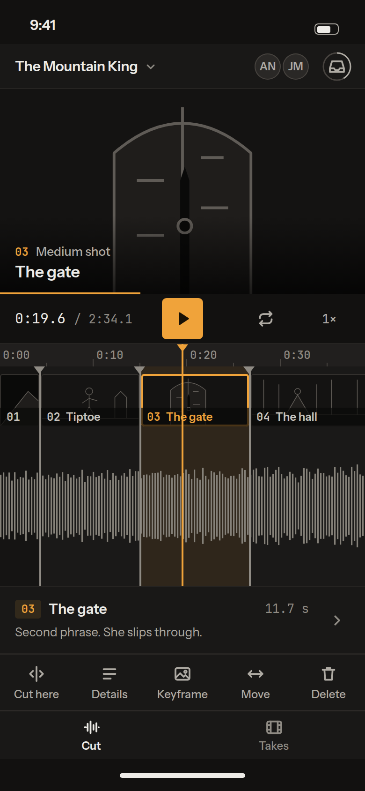
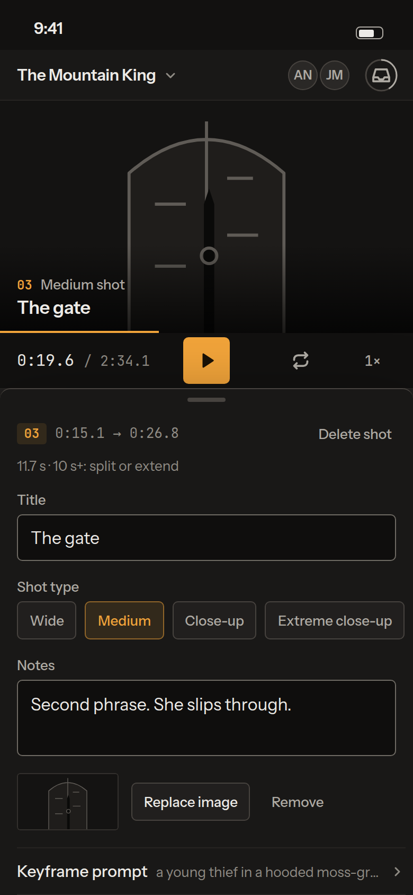
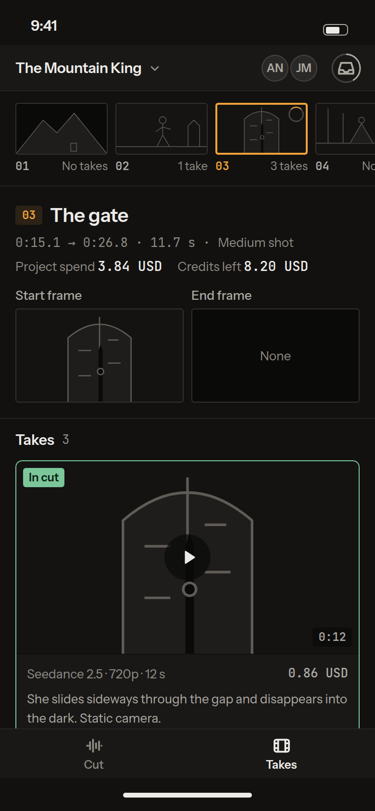
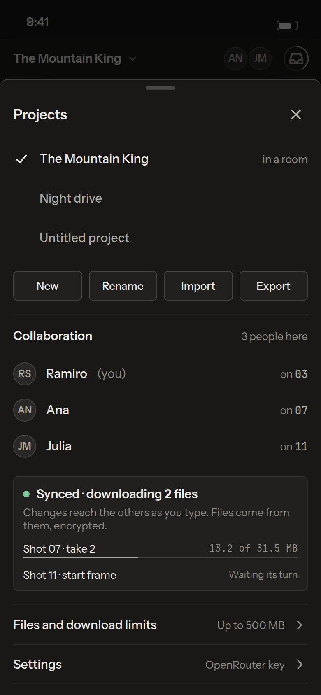
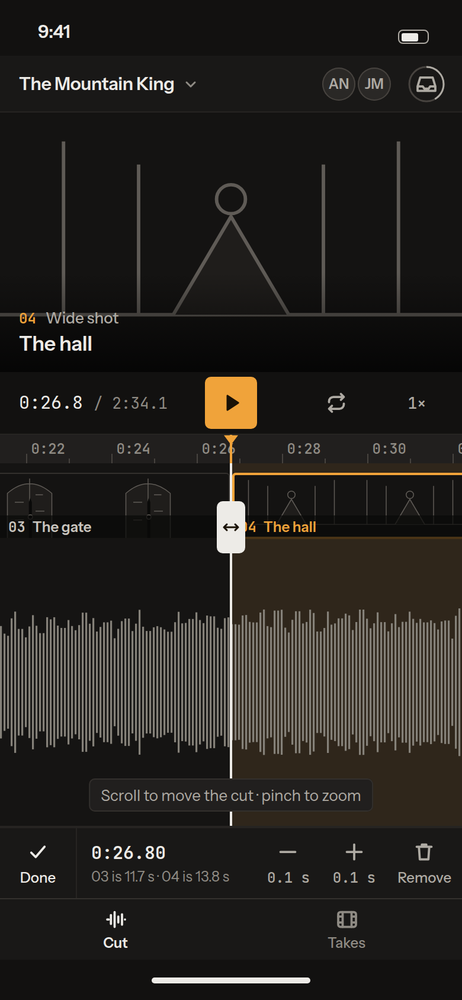
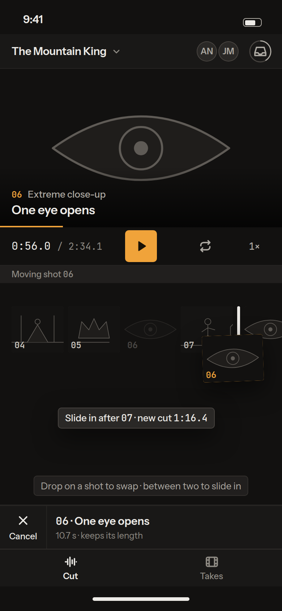
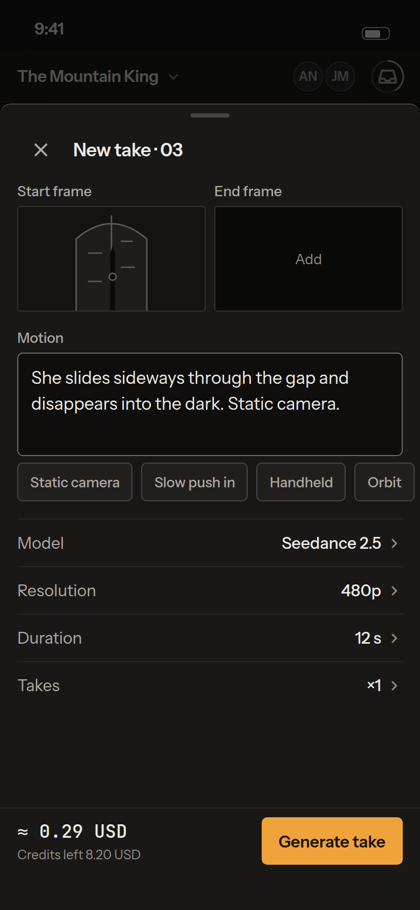
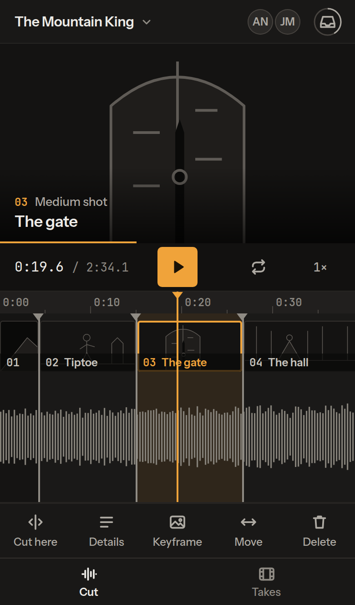
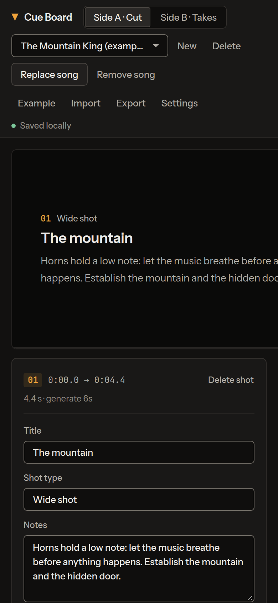
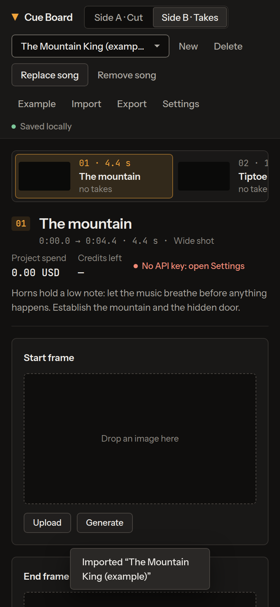

# Cue Board on a phone: plan

## Status (v1 shipped on `feat/mobile-v1`, 2026-10-29)

**2026-11-12: the layout below was replaced by direction B** (`docs/specs/mobile-redesign-b.md`, report in `docs/specs/mobile-redesign-b-report.md`): one top row with the Cut / Takes switch, the picture as the play button, a timeline that fills the rest, one bar that follows the selection, Delete / Loop / Speed in the shot's More sheet, a sectioned Project sheet. Pinch zoom, double-tap Fit and a landscape viewer (view only) are in with it. The transport row, the peek row, the zoom buttons and the bottom tab bar are gone from the phone. Everything else in this plan (gestures, sheets, storage, the iPhone-only list) still stands.

The owner's decisions changed the scope: v1 includes touch cut editing (from v2), installability, a "takes only on Wi-Fi" setting; no landscape design and no generation on the phone.

**In v1:** phone layout below 820 px (desktop unchanged above it); app bar (project name opens the Project sheet, you + 2 + N, files indicator); Cut / Takes tabs; preview (tap plays); transport; fixed-centre timeline, viewport-sized canvas, scrolling seeks, tap selects, − Fit + zoom (12 px/s to start); **Cut here**, cut grips (drag to trim, tap → ±0.1 s with a readout), hold a shot 450 ms to move it (desktop swap / slide rules and chip), Move → Earlier / Later, Delete (two taps), Photo; peek row (from 700 px tall); details sheet (half height, full while typing, ends at the keyboard via `visualViewport`, prev / next, shot type chips); side B rail, frames upload, references, takes (Use in cut, Play in cut; Generate, From start, Retry and the generation panel hidden); Project sheet (projects, New, Rename, Import, Export, song, room: people "on 03", state, Files, Join / Leave, Settings, Copy shot list, Delete, the Add to Home Screen note on iOS); dialogs and the files panel as bottom sheets; **Download takes and clips only on Wi-Fi** (default on for phones, applied in the phone layout only; `navigator.connection` where it exists, else they wait), size confirmation before a phone download, **Download everything now**; `manifest.webmanifest`, two icons, iOS meta; `navigator.storage.persist()` on phones and installed apps; the song picker's extension list; 16 px inputs, 44 px targets, safe areas, `dvh`, no double-tap zoom, no pull-to-refresh. No service worker (not needed to install on iOS 26 or Chrome).

**Checks:** `node design/mobile-check.mjs . design/shots/mobile` (iPhone 14 and Pixel 7 emulation, CDP touch): 94/94.

**Remaining:** pinch zoom; "scroll moves the cut" mode; landscape layout; generation (v3); swipe between shots on the sheet head (buttons only now); reconnect-on-resume in `collab-client`; take cards create `<video>` on tap (iOS video limit); export without base64; a service worker for offline launch; and everything under "iPhone only" below, never run on a device yet.

## Summary

**Recommendation.** We add a phone layout to the same `index.html`: a CSS layer below 820 px plus about 300 to 400 lines of script. There is no second app and no build step, the phone uses the same elements and the same IDs, and desktop is unchanged. The layout borrows the shape every mobile editor shares (CapCut, iMovie, Premiere on iPhone): the preview at the top, a timeline under a fixed centre playhead, a toolbar for the selected shot at thumb height, and bottom sheets for details. We copy the shape only. Colour, type and the single orange are ours (`DESIGN.md`).

**v1 (about 7 working days):** open a project or a room link on the iPhone, play the animatic, scrub by scrolling the timeline, pick a shot, edit its title, type, notes and prompts, review takes (play, Use in cut), and see who's here and how files are doing. Cutting is limited to **Cut here** at the playhead. Moving cuts, reordering and generating come later: v2 (gestures, about 6 days) and v3 (generation, about 6 days).

**Biggest risk.** In a normal Safari tab, iOS deletes a site's IndexedDB after 7 days of Safari use without a visit ([WebKit](https://webkit.org/tracking-prevention/)). A phone-only project could disappear. Home-screen web apps are exempt. So v1 asks to be installed (a manifest and icons, 3 small new files), and in a room the others keep copies.

**Open questions for the owner** are at the end (5, each with a recommended answer).

| Side A: shot selected | Shot details | Side B: takes | Project and room |
|---|---|---|---|
|  |  |  |  |

| v2: move a cut | v2: reorder | v3: generate | Same screen in a Safari tab |
|---|---|---|---|
|  |  |  |  |

The mocks are in `mocks.html` (`?screen=cut|details|takes|project|trim|reorder|generate|safari`; with no parameter it shows all of them). They use the app's real tokens, copied, and no app code. `node docs/mobile/shoot.mjs` serves the repo on 127.0.0.1:3371 and re-takes every image at 390×844, DPR 2, with touch emulation. On every screen it also checks for horizontal overflow and for targets under 44 px; the current images pass with 0 findings, and no request leaves 127.0.0.1.

---

## 1. Today on a phone (measured)

This is Chromium with iPhone-size emulation (390×844, touch), loading the example project (`shoot.mjs --only=today`):

| | Measured |
|---|---|
| Page width | 514 px for a 390 px screen, so the page scrolls sideways |
| Header | about 190 px tall, wrapping onto 5 rows |
| Timeline | starts at y = 1089, more than a screen down |
| Touch targets | 25 of 38 visible controls are under 44 px |
| Text inputs | 13 px. iOS zooms the page when focusing an input under 16 px (well-known behaviour; check on the iPhone) |

| Side A today | Side B today |
|---|---|
|  |  |

Things in the code that break on touch, read from `index.html` on `main`:

- **The timeline can't be panned with a finger.** `#tl{touch-action:none}` (line 252) plus pointer-capture scrubbing means any touch scrubs. Panning a zoomed timeline only works with a wheel.
- **Cut handles are 14 px wide** (`boundaryAt`, ±7 px). A finger needs 44.
- **Strip reorder starts after 7 px of movement** with no long-press. On touch that competes with the strip's own horizontal scroll, and the browser takes the gesture and sends `pointercancel` ([MDN, touch-action](https://developer.mozilla.org/en-US/docs/Web/CSS/touch-action)).
- **The timeline canvas is as wide as the zoomed song**: up to 30,000 CSS px, times `devicePixelRatio` (3 on iPhone), times 132 px tall. iOS caps one canvas at 16.7 M pixels ([reported](https://pqina.nl/blog/canvas-area-exceeds-the-maximum-limit/)), so on the example song the waveform would go blank past about 90 px/s of zoom. Chrome has a per-side cap of about 32,767 px ([old Blink source](https://chromium.googlesource.com/chromium/blink/+/HEAD/Source/core/html/HTMLCanvasElement.cpp)); at DPR 2 that may already bite on desktop at high zoom, which is worth a separate check.
- **The song picker uses `accept="audio/*"`.** On iOS that is reported to hide audio files ([WebKit bug 242110](https://bugs.webkit.org/show_bug.cgi?id=242110)). Listing extensions as well (`audio/*,.mp3,.m4a,.wav,.aac,.flac`) is the reported workaround.
- **Keyboard-only actions.** Space, M, L, ←/→ and [ ] have no touch equivalent except the Cut and Loop buttons. **Hover-only information** (native `title` tooltips, the media indicator's label) never shows on touch.
- **`100vh`** in `--stage-h`. On iOS that is the large viewport, taller than what's visible while the toolbars show.
- **Export** turns every media file into base64 inside one JSON string in memory (`exportProject`). With video takes of hundreds of MB, that is the kind of allocation iOS kills a tab for (assumed, not measured).
- **Outside a room the app never calls `navigator.storage.persist()`.** Only the collaboration client does (`media.mjs:502`).

What already works in our favour: input is all Pointer Events (one path for mouse and touch). `viewport-fit=cover` is set. Clip `<video>` elements are `muted playsinline`, which is allowed to autoplay inline ([WebKit](https://webkit.org/blog/6784/new-video-policies-for-ios/)). The song is an `<audio>` element started from a tap. The app saves on `visibilitychange` and `pagehide`, and media transfers resume from stored chunks (`docs/media-p2p.md`).

## 2. What we take from mobile editors

These sources cover iMovie, Premiere on iPhone (Premiere Rush was discontinued in 2026, [Adobe](https://helpx.adobe.com/premiere-rush/premiere-rush-discontinuation.html)), Final Cut for iPad, CapCut and InShot. Apple and Adobe pages are official; the CapCut and InShot material comes from third-party write-ups (marked "reported").

1. **Preview on top, timeline in the middle, tools at the bottom.** Every editor checked does this. The thumb lives at the bottom, so actions go there and reading goes at the top.
2. **The playhead stays put and the timeline scrolls under it.** iMovie: "Scroll the timeline to position the playhead" ([Apple](https://support.apple.com/guide/imovie-iphone/arrange-video-clips-and-photos-knac788312/ios)). For us this is the key idea: native momentum scroll *is* scrubbing, so scrubbing and panning never fight.
3. **Pinch to zoom the timeline.** You zoom in to make edges easier to grab ([iMovie](https://support.apple.com/guide/imovie-iphone/navigate-in-the-timeline-knaeca4b0ea2/ios), [Final Cut for iPad](https://support.apple.com/guide/final-cut-pro-ipad/deveddea57f8/ipados)).
4. **Tap selects, and the bottom toolbar becomes that thing's tools.** This holds in iMovie ([Apple](https://support.apple.com/en-us/102353)), in Premiere on iPhone where Split is in the bottom toolbar ([Adobe](https://helpx.adobe.com/premiere/mobile/manage-clips/split-clips.html)), and in CapCut ([reported](https://www.hollyland.com/blog/topics/capcut-video-editing)).
5. **Touch and hold to lift, then drag to reorder.** The clip "pops off the timeline" ([iMovie](https://support.apple.com/guide/imovie-iphone/arrange-video-clips-and-photos-knac788312/ios), [Premiere](https://helpx.adobe.com/premiere/mobile/manage-clips/rearrange-clips.html)).
6. **Split happens at the playhead**, never at a finger position ([CapCut](https://www.capcut.com/resource/split-video-into-parts)). This matches our **Cut here**.
7. **Sheets have a large drag-handle zone** at the top: 48 dp in Material ([M3](https://m3.material.io/components/bottom-sheets/accessibility)).
8. **Targets are 44 pt** in [Apple's HIG](https://developer.apple.com/design/tips/) and 48 dp in [Material](https://m3.material.io/foundations/designing/structure). WCAG 2.2 asks for 24 px at AA ([2.5.8](https://www.w3.org/WAI/WCAG22/Understanding/target-size-minimum.html)) and 44 px at AAA ([2.5.5](https://www.w3.org/WAI/WCAG22/Understanding/target-size-enhanced.html)). We use 44.

What we don't take: CapCut's white selection frame and yellow handles (our selection is orange and means one thing), its icon set, multi-track timelines, effects and text, and the big Export button (we don't render video).

## 3. Gesture map

| Where | Gesture | Does | Phase |
|---|---|---|---|
| Timeline | Horizontal scroll or fling | Moves the song under the fixed playhead (seek). While playing, a touch pauses the auto-follow until the finger lifts. | v1 |
| Timeline | Tap a shot tile | Selects it (orange) and seeks to its start | v1 |
| Timeline | Pinch | Zooms around the playhead | v2 (v1 has Fit only) |
| Timeline | Double-tap the ruler | Fit the whole song | v2 |
| Timeline | Tap a cut marker (44 px zone) | Selects the cut and parks it under the playhead: **move cut mode** | v2 |
| Move cut mode | Scroll | Moves the cut with the playhead. Readout shows the time and both shot lengths. | v2 |
| Move cut mode | Drag the grip | Moves the cut directly (coarse) | v2 |
| Move cut mode | −0.1 s / +0.1 s | Nudge | v2 |
| Timeline | Touch and hold a tile (500 ms) | Lifts it: **reorder mode**. Drop on a shot to swap, or between two to slide in (the desktop rules and the same chip) | v2 |
| Toolbar | Cut here | Adds a cut at the playhead (the M key). It works while playing, which is how you tap along to the music. | v1 |
| Preview | Tap | Play / pause | v1 |
| Peek row | Tap, or swipe up | Opens shot details | v1 |
| Sheet | Drag the grabber down, tap the backdrop, or Escape | Closes it. Details has two heights (half, full); it goes full while typing. | v1 |
| Shot details | Swipe left / right on the sheet head | Next or previous shot without closing | v1 |
| Rail (side B) | Horizontal scroll, tap | Pick a shot | v1 |
| Take | Tap the video | Plays inline (`playsinline`) | v1 |
| Anywhere | Pull to refresh | Disabled on the app shell (`overscroll-behavior: none`), so a scrub can't reload the page | v1 |

Every gesture also has a visible button. Gestures are shortcuts, never the only way: VoiceOver users and anyone who can't pinch still get there.

## 4. Screen by screen

### Navigation model

- **App bar (48 px):** the project name as a button that opens the Project sheet, then up to 2 collaborators' initials (+N beyond that), then the files indicator. This is the same icon and the same states as desktop: ring while files arrive, hollow or error dot. The brand, the save status and all the file actions leave the bar.
- **Bottom tab bar (52 px + safe area): Cut / Takes.** It is navigation, so it stays neutral: selected is `ink` and semibold, never orange.
- **A toolbar** for the selected shot (60 px) sits above the tab bar on side A.
- **Sheets for everything else.** They are built on `<dialog>`, which gives focus trapping, Escape and a backdrop for free, and they stay in the same file with no library.

### Desktop → phone inventory

| Desktop | Phone | Why |
|---|---|---|
| Brand | Dropped | 48 px of title bar is worth more than a logo |
| Side switch (segmented) | Bottom tabs, Cut / Takes | Thumb reach. The side letters are desktop wording. |
| Project picker, New, Rename, Delete | Project sheet (from the title) | One place for the project; the list is the same `menuitemradio` set |
| Presence initials | App bar (2 + "+N"); full list with "on 07" in the Project sheet | The bar has room for two |
| Load / Replace / Remove song | Empty state on side A (Load song is the primary there); Replace and Remove in the Project sheet | Rare actions move out of the way |
| Example, Import, Export | Project sheet. Export in v1 is without the song by default and warns above 200 MB (memory). The share sheet comes in v3. | See §5, files |
| Settings dialog | Full-height sheet from the Project sheet (key, Test key, frame model) | Same form, 16 px inputs |
| Media indicator + files panel | Same indicator in the app bar; the panel becomes a sheet (list, limits, Pause, Download all now) | Hover label → its words appear in the sheet header |
| "Saved locally" status | Hidden; errors arrive as a toast | No room, and it's quiet anyway |
| Song bar | A slim row above the preview, only when the song is missing or arriving | Nothing shows when all is well |
| Monitor | Full-width 16:9 preview, caption on a scrim, 2 px orange progress | Same rules as desktop |
| Transport: Play, timecode, Loop, Speed | One row: timecode · **Play** (primary, centred) · Loop toggle · Speed (tap cycles 1× / 0.75× / 0.5×) | 44 px targets |
| Cut (M) | Toolbar **Cut here** | Keyboard → button |
| Zoom −, Fit, + | Fit in v1 (double-tap the ruler or a toolbar item), pinch in v2 | |
| Timeline canvas | Fixed-centre timeline. The canvas is the size of the viewport, redrawn on scroll; a tall shot track carries thumbnails | Removes the canvas size limit; scrolling is scrubbing |
| Storyboard strip | Merged into the timeline's shot track | Two views of one sequence don't fit on a phone; the tiles carry number, title, thumbnail, presence |
| Strip drag reorder | Touch and hold a tile (v2) | |
| Inspector | Peek row + shot details sheet: title, shot type chips, notes, keyframe, prompts | Same `<input>`s re-laid out, so the collaboration caret logic and the bindings keep working |
| Upload image, GIF or clip | Toolbar **Keyframe** → file picker (Photos or Files) | |
| Delete shot | Toolbar and the sheet head, with the existing two-tap confirm | |
| Copy shot list | Project sheet | Rare |
| Keyboard reference | Dropped below 820 px | No keyboard |
| Side B shot list | Horizontal rail of 96 px thumbnails with a take count and a spinner when one is rendering | Same as desktop under 900 px |
| Side B header (title, time, spend, credits, notes) | Same, stacked | |
| Frames (Upload, Generate, From start, Clear) | v1: view and Upload only. Generate and From start in v3 | Generation is v3 |
| References | v3 | Generation input |
| Generation panel | v3: full-height sheet (frames, motion prompt, chips, model/res/duration/takes as rows, price, **Generate take**) | Price before spending stays visible next to the button |
| Takes grid | One column of cards: Play in cut / Use in cut, Next shot, and ⋯ for Download, Delete, Retry, Forget | One action row per card |
| Join dialog | Full-height sheet; a `#join=` link opens the app straight into it | v1, so a friend can join from a phone |
| Toast | Above the toolbar and tab bar, clear of the safe area | |

### Side A, shot selected (`?screen=cut`)

From the top: preview, transport, the timeline with a fixed orange playhead, shot tiles in the track (the selected one has the orange edge, and its region carries the warm tint), neutral cut markers, the waveform, the peek row for the selected shot, the shot toolbar, then the tabs. On a 390×844 screen the whole deck fits with no scrolling. The orange appears only where `DESIGN.md` allows it: playhead, selected shot, Play, the shot-number chip and the monitor's progress line.

### Shot details (`?screen=details`)

The sheet opens to half height, so the preview and Play stay visible: you can loop the shot while writing its notes. Shot type becomes a row of chips (the datalist values), with the input still there for a custom value. The prompts are rows that open in place. When a field takes focus the sheet goes full height, and the field is kept above the keyboard using `visualViewport`. iOS doesn't resize the layout for the keyboard, and `interactive-widget` is Chrome-only ([Chrome](https://developer.chrome.com/blog/viewport-resize-behavior)).

### Side B, takes (`?screen=takes`)

A rail of shots, the shot header with spend and credits, the frames as they are, then one take per row. The take in the cut keeps the `ok` edge and badge. "Use in cut" stays the tinted secondary, so a list of takes doesn't become a wall of orange.

### Project and collaboration (`?screen=project`)

Projects, then the room: who's here and which shot they're on, and the same state words as the desktop indicator (*Synced*, *Offline, changes will sync*, *Downloading 2 files*), with the arriving files and their progress lines. Files and limits, Settings, Leave collaboration and Delete project sit at the end.

### v2: moving a cut (`?screen=trim`) and reordering (`?screen=reorder`)

 

Moving a cut parks it under the playhead. Then **scrolling the timeline moves the cut**, so you never have to hit a hairline with a finger. The selected cut is drawn in `ink`, not orange: cut markers stay neutral, as on desktop. A 24×44 grip is there for coarse drags, and ±0.1 s for fine ones. Reorder uses the desktop's swap and slide rules and its chip text.

### v3: generate a take (`?screen=generate`)

The generation panel becomes one sheet. The price and credits sit next to the only primary button, so the cost is read before the tap.

### Portrait sizes, landscape, tablet

- **390×844 and 360×800 portrait** are the target. The deck uses fixed rows plus a flexible timeline. At 360 px the toolbar labels still fit (5 × 72 px), as shown in `shots/cut-360.png`.
- **In a Safari tab** the visible height is about 664 px (`?screen=safari`). Below 700 px tall the peek row hides, and the timeline keeps at least 150 px. Sizes use `dvh` ([web.dev](https://web.dev/blog/viewport-units)) and `env(safe-area-inset-*)`.
- **Landscape phone** (`max-height: 500px` and a coarse pointer): v2. The preview takes the left half and the timeline and toolbar the right; rotating while playing is the "watch it full-screen" gesture.
- **Tablet.** Current iPads are 820 px or wider in portrait (Air and 10th gen 820, Pro 11" 834), so they keep the desktop layout. `(pointer: coarse)` raises the targets to 44 px at any width, and the fixed-centre timeline and its gestures apply to every coarse pointer. An iPad mini (744 px) or an older 810 px iPad in portrait gets the phone layout, stretched. That works, but it's the first thing to check on an iPad.

## 5. Technical reality check

D = documented (WebKit, Apple, MDN, Chrome docs), R = reported (bug trackers, blogs, forums), C = read in our code, A = assumed and needing a check on a real iPhone.

| Topic | What we know | Consequence for the plan |
|---|---|---|
| Audio unlock | Media with sound starts only from a user gesture; `play()` rejects otherwise ([D](https://webkit.org/blog/6784/new-video-policies-for-ios/)). The app plays from the Play tap (C). | Keep play inside the tap handler. "Cut here" while playing is fine. |
| Silent switch | With the ringer off, Web Audio is muted but media elements keep playing ([R](https://bugs.webkit.org/show_bug.cgi?id=264473)). We use `<audio>` (C). | Nothing to do. Never move playback to Web Audio. |
| Screen lock / background | iOS suspends JS about 3 s after leaving the app ([R](https://frontendmasters.com/courses/background-javascript/observing-mobile-background-javascript)); WebSockets drop ([R](https://support.qlik.com/articles/000107419)). Chrome freezes hidden pages and advises closing sockets on `freeze` and reopening on `resume` ([D](https://developer.chrome.com/docs/web-platform/page-lifecycle-api)). Audio stopping on lock in home-screen apps is reported ([R](https://developer.apple.com/forums/thread/762582)). | Doc sync: on `visibilitychange` → visible, `pageshow` and `online`, reconnect at once instead of waiting for the backoff (small change in `collab-client`). Edits made offline already merge (C). The animatic stops when the phone locks; that's acceptable. |
| WebRTC after background | Behaviour not confirmed. Safari may not fire `close` when the other end dies ([R](https://bugs.webkit.org/show_bug.cgi?id=303052)). Our client tries WebRTC once per peer per session, then uses the relay (C, `docs/media-p2p.md`). | After a resume, transfers continue over the relay (slower, never stuck; chunks already stored are kept). v2: re-offer a data channel on resume. A phone is a poor seed, so don't count on it to serve files to others. |
| Storage eviction | Safari deletes script-written storage (IndexedDB) after 7 days of Safari use without a visit; **home-screen web apps are exempt** ([D](https://webkit.org/tracking-prevention/)). | v1 adds a manifest and icons. A one-time note in a Safari tab says "Add to Home Screen to keep your projects on this iPhone." In a room, collaborators keep copies. |
| Quota and persist | Up to 60% of the disk per origin in the browser, the same for home-screen apps; `persist()` is granted by heuristics such as home-screen use; no prompt since Safari 17 ([D](https://webkit.org/blog/14403/updates-to-storage-policy/)). | Call `persist()` for every project once it holds media, not only in rooms (today only `collab-client` asks). |
| Large files | Videos picked from Photos are recompressed; picked from Files they're kept as they are ([R](https://developer.apple.com/forums/thread/731042)). Blobs live in IndexedDB as today (C). OPFS exists but is Worker-only for sync handles ([D](https://webkit.org/blog/12257/the-file-system-api-with-origin-private-file-system/)). | No storage change. Default auto-download on phones: frames and the song; takes on tap (question 3). Export avoids base64 of big media (v3: stream, or share the files). |
| Canvas | 16.7 M pixel cap per canvas and a 224 to 384 MB total canvas budget on iOS ([R](https://pqina.nl/blog/canvas-area-exceeds-the-maximum-limit/), [R](https://www.pqina.nl/blog/total-canvas-memory-use-exceeds-the-maximum-limit/)). Our canvas grows with zoom (C). | The timeline canvas becomes viewport-sized (390 × 3 × about 250 × 3 ≈ 0.9 M px) and redraws about 130 bars per frame on scroll. Assumed cheap; we'll measure it on the iPhone. |
| Viewport | `dvh`/`svh`/`lvh` since Safari 15.4 ([D](https://web.dev/blog/viewport-units)). Safe areas need `viewport-fit=cover` ([D](https://developer.mozilla.org/en-US/docs/Web/CSS/env)), which is already set (C). No VirtualKeyboard API on iOS ([R](https://bugs.webkit.org/show_bug.cgi?id=230225)). `visualViewport` resize can lag about 700 ms ([R](https://blog.iftechfoundation.org/2024-12-13-2023-grant-report-accessible-if-on-ios-dannii-willis-.html)). | The shell is `100dvh`. The sheet goes full height on focus (no dependence on the keyboard event). Inputs are 16 px. |
| Touch input | `touch-action` decides who owns a gesture; the wrong one gives `pointercancel` ([D](https://developer.mozilla.org/en-US/docs/Web/CSS/touch-action)). `gesturestart` is Safari-only ([D](https://developer.mozilla.org/en-US/docs/Web/API/GestureEvent)). Pinch built from two pointers on iOS: not confirmed. | The timeline is a native horizontal scroller (`pan-x`); grips are `none`. Pinch uses two-pointer tracking, falling back to `gesturestart` on Safari, with Fit and +/− buttons if both fail. |
| Video | `playsinline` stops iPhone fullscreen; muted autoplay is allowed ([D](https://webkit.org/blog/6784/new-video-policies-for-ios/)). There are limits on many `<video>` elements, with one report of 16 ([R](https://forums.tumult.com/t/ios-loads-a-maximum-of-16-videos-then-gives-a-black-display/9541)). | Take cards show a poster image and create the `<video>` only on tap. Timeline tiles are images, never videos (a clip's tile uses a captured frame). |
| Install (PWA) | iOS 26 opens any site added to the Home Screen as a web app, even without a manifest ([D](https://webkit.org/blog/17333/webkit-features-in-safari-26-0/)). Chrome needs a manifest with icons ([D](https://web.dev/articles/install-criteria)). Web Push is home-screen only ([D](https://webkit.org/blog/13878/web-push-for-web-apps-on-ios-and-ipados/)). | v1: `manifest.webmanifest` and two PNG icons next to `index.html`; `file://` simply ignores them (A). v2: a service worker so the installed app opens offline. It's one more file and is skipped on `file://`. |
| Share and files | `navigator.canShare({files})` works since Safari 14 ([D](https://web.dev/web-share)). `<a download>` on iOS since 13, reliability for blobs not confirmed ([R](https://bugs.webkit.org/show_bug.cgi?id=167341)). `accept="audio/*"` hides audio files ([R](https://bugs.webkit.org/show_bug.cgi?id=242110)). | v1 fixes the song `accept`. Download of a take uses the share sheet when `canShare` says yes (Save to Files or Photos), otherwise `<a download>`. |
| Haptics | The Vibration API isn't in iOS Safari (A). | No haptic feedback; lift and drop are shown with a visible change and a shadow. |

## 6. How it's built

- **One file, no build, no third-party requests.** Phone layout is `@media (max-width: 819px)`, matching PRODUCT.md's 820 px floor for the desktop layout. Targets are `@media (pointer: coarse)`. Landscape phone is `(max-height: 500px) and (pointer: coarse)`.
- **Same DOM.** The inspector *is* the details sheet, and the monitor *is* the preview. Only the tab bar, the toolbar, the peek row and the sheet shells are new markup, hidden on desktop. All existing handlers and the collaboration bindings (which rely on field IDs and carets) keep working.
- **Mobile token layer.** It sits in the same `:root` and changes values, not names: `--text-sm` 13, `--text-md` 15, inputs 16, `--h-md` 44, `--h-sm` 36 with a 44 hit area, plus `--safe-*`, `--appbar-h`, `--toolbar-h` and `--tabbar-h`. It's shown in `mocks.html` as `.m`. No new colours. The tab bar is neutral, and the moved cut is `ink`.
- **New script, about 300 to 400 lines:** a sheet controller (detents, drag to close, focus return); timeline touch mode (`scrollLeft ↔ time`, a viewport-sized canvas, auto-follow while playing, tap to select); peek and toolbar rendering; a reconnect on resume (in `collab-client`, so `collab.js` gets rebuilt). That's roughly 4 to 6% on a 176 KB file.
- **Deploy.** `manifest.webmanifest` and `icons/` join the list of files copied to hephaestus (update `CLAUDE.md`). The sync server is unchanged.
- **Accessibility.** Sheets are `<dialog>` with labelled headings, and focus returns to what opened them. The tab bar is `role="tablist"`. Every gesture has a button. The timeline exposes the playhead as a slider (`aria-valuetext` "0:19.6, shot 03 The gate"). Reduced motion turns off sheet slides and fling animation. Contrast is unchanged (same tokens). The 12 px floor stays, used only for the ruler, the toolbar and tab labels, and badges. Meta text goes up to 13 px, body text and controls to 15, inputs to 16. Nothing is smaller than on desktop.
- **Coordination.** Another branch is reworking the top bar in `index.html`. v1 starts after that lands and builds on it.

## 7. Roadmap

Estimates are working days for one developer, including tests and a review session on the owner's iPhone.

| Phase | Scope | Effort | Proves it |
|---|---|---|---|
| **v1: review and notes** | Phone layout, app bar, tab bar, preview, transport, fixed-centre timeline (scroll = seek, tap = select, Fit), viewport canvas, peek, details sheet (all text fields, keyframe upload), Cut here, Delete shot, side B review (rail, header, frames view and upload, takes with Play / Use in cut / Next shot / ⋯), Project sheet (projects, room, presence, state, files sheet, Settings, Join from a link), 16 px inputs, safe areas, `dvh`, song `accept` fix, manifest and icons, the "Add to Home Screen" note, `persist()`, reconnect on resume | 7 days | Playwright (Chromium, 390×844 and 360×800, `hasTouch`): no horizontal overflow; every visible control ≥ 44 px; every input ≥ 16 px; scroll moves the time and the selection; tap selects; sheets open, close and restore focus; a title edit syncs to a second context through a local sync server (port 3360, as `design/collab-check.mjs` does); `#join=` opens the Join sheet; files states render. Desktop regression: existing `design/*` runs at 1440 and 820 unchanged. **iPhone only:** audio starts on tap with the silent switch on; keyboard over the sheet; safe areas; scroll-scrub feel; reconnect after locking the screen; install and launch from the Home Screen; the audio file picker |
| **v2: cut editing by touch** | Pinch zoom and double-tap Fit, move-cut mode (scroll, grip, ±0.1 s, Remove), long-press reorder (swap and slide as on desktop), landscape layout, service worker for offline launch, WebRTC re-offer on resume | 6 days | Playwright with CDP touch events: two-finger pinch changes pixels per second around the playhead; a 500 ms hold lifts a tile, and the swap and slide plans equal desktop's for the same drops; nudges change `start` by 0.1; canvas pixels stay ≤ 3 × viewport at any zoom; offline reload of the installed app (Chromium). **iPhone only:** pinch reliability in Safari, long-press vs. text selection, precision of a cut on a real song |
| **v3: generation** | Frames (Generate, From start, variants), references, the generate sheet with price, Retry and Forget, share-sheet download, export without base64 (or per-file share) | 6 days | Playwright with the OpenRouter API routed to a fake in the page (as `collab-check` does; no real calls): price shown before the tap, the take lands, Use in cut plays it in side A. **iPhone only:** picking from Photos and Files, the share sheet, memory with a 300 MB take |

Each phase ships on its own and is useful without the next one. After v1 we watch how the phone is actually used for two weeks before committing to v2.

## 8. Open questions for the owner

1. **What is the phone for?** *Recommended:* reviewing and writing first (v1). Editing cuts by touch (v2) only if you find yourself wanting it after two weeks with v1.
2. **OK to add "install to Home Screen"** (a manifest and two icons, deployed with `index.html`)? *Recommended:* yes. It's what stops iOS deleting phone-only projects after 7 days, and it gives a full-screen app.
3. **Should a phone download takes automatically in a room?** *Recommended:* no. Frames and the song download automatically (small, needed to play); takes download on tap, and the phone's per-file limit defaults to 100 MB.
4. **Landscape?** *Recommended:* v2, and only as "preview big, timeline beside it"; no separate landscape editor.
5. **Generation on the phone at all (v3)?** *Recommended:* decide after v1. If yes, keep the price next to the only primary button, as in the mock, and leave references and variant picking as they are on desktop.

## 9. What we will not do

- No native app, no app store, no separate mobile codebase, framework, gesture library or build step.
- No CapCut look: no white selection frames, yellow handles, their icons or any of their assets. We borrow the layout, not the skin.
- No second accent, no coloured tab bar, no orange cut markers. Navigation stays neutral.
- No multi-track timeline, effects, transitions, text overlays or video rendering or export on the phone.
- No hover-only or keyboard-only actions on touch; no gesture without a button.
- No generation in v1, and no background work while the phone is locked (iOS won't run it).
- No push notifications for finished takes (home-screen only on iOS, and it needs a push server we don't have).
- No undo in this plan. The app has none on desktop either; it deserves its own small project, and until then deletes keep the two-tap confirm.

## Sources

Apple: [iMovie arrange](https://support.apple.com/guide/imovie-iphone/arrange-video-clips-and-photos-knac788312/ios), [iMovie timeline](https://support.apple.com/guide/imovie-iphone/navigate-in-the-timeline-knaeca4b0ea2/ios), [iMovie split](https://support.apple.com/en-us/102353), [Final Cut for iPad](https://support.apple.com/guide/final-cut-pro-ipad/deveddea57f8/ipados), [HIG tips](https://developer.apple.com/design/tips/). Adobe: [Premiere iPhone split](https://helpx.adobe.com/premiere/mobile/manage-clips/split-clips.html), [rearrange](https://helpx.adobe.com/premiere/mobile/manage-clips/rearrange-clips.html), [Rush discontinued](https://helpx.adobe.com/premiere-rush/premiere-rush-discontinuation.html). CapCut / InShot (reported): [CapCut split](https://www.capcut.com/resource/split-video-into-parts), [CapCut toolbar](https://www.hollyland.com/blog/topics/capcut-video-editing), [InShot](https://dev.to/the_rainbow/mastering-video-editing-with-inshot-a-comprehensive-guide-4noe). Material: [bottom sheets](https://m3.material.io/components/bottom-sheets/accessibility), [targets](https://m3.material.io/foundations/designing/structure). WCAG: [2.5.8](https://www.w3.org/WAI/WCAG22/Understanding/target-size-minimum.html), [2.5.5](https://www.w3.org/WAI/WCAG22/Understanding/target-size-enhanced.html). WebKit, MDN, Chrome and the bug reports are linked inline in §1 and §5.

The research was done with web search on 2026-10-29. CapCut's and LumaFusion's own help pages describe their desktop apps, or didn't describe the editing UI, so their phone patterns are marked as reported. Nothing here was tested on a real iPhone yet; everything marked A or "iPhone only" is the list for the first device session.
